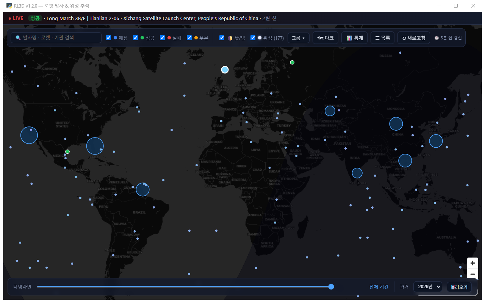

# RL3D — 로켓 발사 & 위성 추적

[최신 릴리스](https://github.com/yim2412/RL3D/releases/latest) · [변경 이력](CHANGELOG.md) · [](https://github.com/yim2412/RL3D/actions/workflows/tests.yml)

전 세계 로켓 발사를 **2D 지도**에 표시하고, 위성이 실시간으로 움직이는 모습을 보여 주는 Windows 데스크톱 앱입니다.
뉴스 상황판 느낌의 어두운 화면이고, pywebview 와 MapLibre GL 로 만든 exe 파일 하나로 실행합니다. 설치는 필요 없습니다.



> 위 화면(v1.7.0)에는 발사장 마커(클러스터), 위성 773개의 실시간 위치, 낮/밤 오버레이가 보입니다. 위성은 stations, visual, GEO, GPS 그룹이고,
> 적도를 따라 늘어선 주황 점이 정지궤도 벨트입니다. 위쪽에는 다음 발사까지 카운트다운하는 속보 띠가, 아래쪽에는 타임라인이 있습니다.

## 기능

- 🗺 **발사 지도**: 전 세계 발사장을 마커로 표시합니다 (🔵예정 / 🟢성공 / 🔴실패 / 🟠부분실패)
- 📋 **상세 패널**: 마커를 누르면 로켓, 기관, 참여 기관, 미션, 궤도, 발사 시각, 이미지, 미션 설명이 나옵니다.
  참여 기관은 **누구를 위한 발사인지**를 알려 줍니다(`Rocket Lab → BlackSky (민간)`, `SpaceX → NRO (정부)`).
  실패하거나 미뤄진 발사는 그 사유도 보여 줍니다. 범주형 정보는 한국어로 표시합니다
- ▶ **중계 링크와 발사 소식**: 발사별 유튜브/X 중계를 버튼 하나로 기본 브라우저에서 엽니다. 생중계 중이면 배지를 붙입니다.
  지연, 재조정, 리프트오프 같은 소식 타임라인과 미션 패치, 프로그램 태그, 발사 윈도우, "이 발사대 N번째(올해 M)" 기록까지 보여 줍니다
- 🛰 **위성 상세**: 위성을 누르면 고도, 속도, 궤도 주기, 경사각, **근지점~원지점**, 이심률을 실시간으로 갱신합니다.
  누르는 영역이 넓어서 움직이는 점도 쉽게 고를 수 있습니다
- 🔥 **재진입 예보**: 궤도가 내려가는 물체에는 `이대로면 약 1일 뒤 재진입`을 적고, 30일 안이면 `재진입 임박` 배지를 붙입니다.
  SGP4 가 대기권에서 값을 내지 못하는 시점을 이진 탐색으로 구하므로 외부 데이터가 필요 없습니다. 실측 2,926건 중 **190건(6.5%)** 이 해당합니다.
  궤도를 올리는 기동은 계산에 넣지 않았고, 그 가정도 화면에 같이 적습니다. 그래서 ISS 처럼 기동으로 고도를 유지하는 물체에는 예보가 나오지 않습니다
- 🛰 **궤도 데이터 관측 시각**: 지도의 점은 TLE 로 계산한 값이라, **그 TLE 를 언제 관측했는지**가 정확도를 좌우합니다.
  상세에 `3.8일 전 관측`을 적고, 오래되면 경고 색으로 알립니다. 기준은 저궤도 3일, 중궤도와 정지궤도 30일입니다.
  실측에서 50일 된 TLE 는 저궤도에서 **2,880km**, 고궤도에서 **73km** 어긋났습니다. 최신 데이터를 못 받아 이전 데이터를 쓸 때도 그 사실을 알립니다
- 🕒 **정보 갱신 시각**: 상세 패널에 `27일 전` 처럼 **LL2 가 이 발사 정보를 마지막으로 고친 때**를 적습니다.
  툴바의 `N분 전 갱신`은 앱이 데이터를 받아 온 때라서 서로 다른 값입니다. 예정 발사는 실측 중앙값이 27일이라,
  이 줄을 보면 **일정을 얼마나 믿을 수 있는지** 알 수 있습니다(실측 최장 `3.2년 전`).
- 📡 **속보 띠**: 임박한 예정 발사의 카운트다운과 **최근 발사 결과**(성공/실패 배지와 "N시간 전")를 섞어 번갈아 보여 줍니다
- 🚀 **발사 임박 화면**: 60분 안에 발사가 있으면 지도 아래쪽에 큰 카운트다운 카드가 뜹니다. 카드에는 중계 버튼과 발사장 보기가 있습니다.
  발사 시각이 **분 단위까지 확정된 발사만** 띄웁니다(LL2 `net_precision`). 날짜만 정해진 발사에 초 단위 카운트다운을 붙이면
  없는 정밀도를 지어내는 셈이기 때문입니다. `✕` 로 닫은 발사는 이번 실행 동안 다시 뜨지 않습니다
- 👋 **첫 실행 안내**: 처음 열면 지금 화면에 무엇이 몇 건 있는지 숫자로 알려 줍니다
  (`지금 지도에 2026년 발사 98건이 있습니다 (예정 48 · 지난 50)`). 요청을 아끼려고 위성, 히트맵, 과거 연도를
  **기본으로 꺼 두었다는 사실**과 켜는 방법(버튼과 단축키)을 같이 보여 줍니다.
  한 번 닫으면 다시 뜨지 않습니다. 과거 연도 요청은 **버튼을 누를 때만** 보냅니다
- ⌨ **키보드 단축키**: `/` 검색, `S` 사이드바, `R` 새로고침, `T` 시간대, `B` 배경 지도, `C` 통계,
  `G` 위성 그룹, `A` 아카이브 불러오기, `1`~`4` 결과 필터, `5` 위성, `6` 낮/밤, `7` 밀도,
  `Esc` 열린 패널 닫기(위에 덮인 것부터), `?` 도움말입니다. 글자를 입력하는 중에는 단축키가 동작하지 않습니다.
  툴바의 `⋯` 안에 접힌 배경과 통계는 `B`, `C` 로 바로 열 수 있습니다
- 🔍 **검색과 필터**: 발사명, 로켓, 기관으로 찾습니다. 여러 단어는 **단어마다** 찾습니다(`falcon starlink`).
  **한글로도** 찾을 수 있습니다(`스페이스X`, `팰컨 스타링크`, `창정`, `한국`). 결과별로 켜고 끌 수 있습니다
- ☰ **목록 사이드바 (발사 / 위성 / 관심 탭)**: 발사 탭은 필터, 검색, 타임라인을 적용한 목록입니다.
  위성 탭은 이름, NORAD 번호, **소유국과 종류**로 찾습니다(`중국`, `로켓 몸체`, `국제우주정거장`).
  줄을 누르면 그 위치로 이동하고 상세 패널이 열립니다
- 🌐 **발사장 현지 시각**: 상세 패널에 그 발사장의 현지 시각을 같이 적습니다
  (`2026. 09. 10. 오전 08:42 GMT-7`). 내 시각과 같으면 줄을 생략합니다. **추가 API 요청은 없습니다**
- 🚀 **로켓 제원과 부스터 이력**: 상세 패널에서 로켓의 길이, 지름, 이륙 질량, **LEO/GTO 탑재량**, 이륙 추력, 단 수, 첫 비행,
  통산 성적(`통산 630회 · 성공 629 · 실패 1 · 연속 성공 332`)을 볼 수 있습니다.
  **공시 발사가와 LEO kg당 값**도 함께 나옵니다(`5,200만 달러 · LEO kg당 $2,281`).
  재사용 로켓의 경제성이 여기서 드러납니다(실측 Electron $20,000/kg, Falcon Heavy $1,411/kg).
  다만 공시가는 나라마다 채워진 정도가 크게 달라서(미국 49/55, 중국 2/21) 합계나 순위는 내지 않습니다.
  부스터가 배정된 발사는 `B1080 · 29번째 비행 · 착륙 시도 예정 · A Shortfall of Gravitas` 처럼 재사용 이력까지 보여 줍니다.
  **착륙 통산**(`착륙 620회 시도 · 성공 615 (99%) · 연속 315`)도 함께 나옵니다.
  기관 화면에는 그 기관의 착륙 성적을 보여 줍니다. 착륙하지 않는 일회용 로켓 운용사는 이 줄이 없습니다.
  이 정보는 이미 받아 오던 응답에 들어 있어서 **추가 API 요청이 없습니다**
- 🏗 **발사대 재사용 간격과 발사장 통산**: 상세 패널의 기록 줄에 `직전 발사로부터 2.8일 만`,
  `이 발사장 통산 912번째(올해 60)` 를 적습니다. **발사대, 발사장, 기관, 전 세계 네 가지 모두 통산과 올해를 함께** 보여 줍니다.
  예전에는 항목마다 한쪽만 보여 줘서 기준이 다른 숫자가 나란히 있었습니다.
  발사장 화면에는 **통산 횟수를 기준으로** 몇 건을 불러왔는지 밝힙니다
  (`이 발사장은 통산 912회 발사했습니다 — 그중 14건(2%)을 불러왔습니다`).
  실측 범위가 **2.79일 ~ 1541일**이라 크기에 따라 단위를 바꿔 적습니다
- 🛫 **발사장, 기관, 로켓, 계열 화면**: 상세 패널에서 발사장, 기관, 로켓 이름을 누르면 그 대상만의 총 발사 수와 성공률이 나옵니다.
  구성 막대(발사장은 로켓, 기관, 발사대별이고 기관과 로켓은 로켓, 발사장, 연도별)와 예정/최근 발사 목록도 함께 보여 줍니다
- 🚀 **로켓 계열**: 로켓 이름에 변형까지 들어 있어서 `Falcon 9 Block 5` 와 `Falcon Heavy` 가, `Long March` 10종이 서로 따로 놀았습니다.
  상세 패널의 `계열 Falcon · 변형 2종 ›` 으로 계열 전체를 모아 보고, **변형별 막대**로 그 계열에 무엇이 있는지 볼 수 있습니다.
  변형이 하나뿐이거나 데이터에 계열이 없는 로켓(Electron 등)에는 이 줄이 없습니다. 로켓 화면과 같은 목록을 두 번 보여 주지 않기 위해서입니다
- 🗓 **날짜가 정해지지 않은 발사는 그렇다고 알려 줍니다**: 예정 발사의 78%는 LL2 가 월, 분기, 연 단위로만 주는 일정입니다.
  그런 발사에는 초 단위 카운트다운 대신 `2026년 10월 중`, `2026년 4분기 중` 처럼 아는 만큼만 적습니다
  (날짜만 정해진 발사는 `T-3일`, `내일 중`)
- 🔁 **여러 번 눌러도 요청은 한 번만 보냅니다**: 새로고침, 아카이브, 위성은 **이전 요청의 응답이 오기 전에는 다시 보내지 않습니다**
  (`이미 갱신 중입니다`). 발사 API 는 시간당 약 15회로 제한돼 있어서, 연달아 누르는 것이 곧 한도를 쓰는 일입니다.
  자동 갱신과 수동 갱신이 겹쳐도 **나중 요청의 결과를 씁니다**. 늦게 도착한 옛 응답 때문에 화면이 되돌아가지 않습니다
- ⚠ **화면에서 빠진 발사를 알려 줍니다**: 상세를 열어 둔 채 검색, 필터, 타임라인으로 그 발사가 걸러지면
  패널 맨 위에 그 사실을 적고, 지도에 남아 있던 상승 궤적 점선도 지웁니다. 갱신으로 목록에서 아예 빠진
  경우에는 *"마지막으로 받은 내용"* 이라고 따로 적습니다
- ⭐ **관심 발사와 위성**: 상세 패널의 `☆ 관심`으로 담아 두면 지도에서 금색으로 강조되고, 사이드바 **⭐ 관심** 탭에 모입니다. 다음 실행에도 그대로 남습니다
- 🕒 **발사 순서표**: 상세 패널에서 그 발사의 진행 순서를 볼 수 있습니다(`T-38:00 추진제 주입 승인` … `T±0:00 리프트오프` …
  `T+2:26 1단 엔진 정지(MECO)` … `T+8:26 1단 착륙`). 절대 시각은 발사 시각이 **분 단위까지 확정된 발사에만** 같이 적습니다.
  날짜만 정해진 발사에 초 단위 시계를 붙이면 없는 정밀도를 지어내는 셈이기 때문입니다.
  **발사 임박 화면에는 지금 어느 단계인지**를 매초 갱신해 보여 줍니다(`리프트오프 지남 · 다음 최대 동압(Max-Q) T+1:07 · 12초 뒤`).
  이 순서표는 LL2 가 주는 발사사의 공개 계획이고 **실제 중계 값이 아닙니다**. 실측 100건 중 35건에만 있고 대부분 지난 발사입니다. 없으면 이 칸을 그리지 않습니다
- 🚀 **발사 궤적 근사선**: 발사 상세를 열면 지도에 상승 경로를 **점선**으로 근사해 그립니다.
  발사장 좌표와 목표 궤도 경사각으로 방위각을 풀고(`sin A = cos i / cos φ`), 대권을 따라 약 2,200km 를 그립니다.
  **실측이 아니므로** "근사입니다"라고만 하지 않고 **가정을 숫자로** 적습니다(`가정: 경사 98.0°(태양동기) · 방위 203° 남서쪽`).
  저궤도처럼 이름만으로 경사를 알 수 없는 경우(전체의 약 57%)에는 최소 에너지로 가정하고 **그 사실을 함께 밝힙니다**.
  탄도 비행(Suborbital)은 궤도에 들어가지 않으므로 그리지 않습니다
- 🔥 **발사 밀도 히트맵**: 툴바 `밀도`(또는 `7`)로 켭니다. 마커와 클러스터로는 "어디서 몇 번"을 보여 주기 어렵습니다.
  같은 발사장에 완전히 겹친 점은 1건이든 300건이든 똑같이 보이기 때문입니다. 히트맵은 지금 보고 있는 필터 결과에만 반응하고,
  **색 눈금을 데이터에 맞춰 다시 잡습니다**(한 발사장의 최다 건수가 색 띠의 끝). 범례에는 `1건 ~ 최다 N건` 눈금과
  불러온 건수, 기간, 일부만 받은 연도를 함께 적습니다. 아카이브를 안 불러오면 최근 100건만 보고
  "발사 중심"으로 잘못 읽을 수 있기 때문입니다. 아카이브를 많이 불러올수록 뚜렷해집니다
- 🕓 **시간대 전환 (현지 ↔ UTC)**: 이 앱에서는 시간이 중요한데(카운트다운, 발사 윈도우, 순서표, 통과 예측)
  예전에는 **어느 시간대인지 어디에도 적혀 있지 않았습니다.** 지금은 툴바 버튼(`🕓GMT+9` / `🕓UTC`)이 **지금 쓰는 시간대를 늘 보여 주고**,
  누르거나 `T` 를 치면 UTC 와 바뀝니다. 발사 시각, 윈도우, 순서표, 통과 예측, 타임라인 라벨이 **모두 이 스위치 하나를** 따릅니다.
  바꾸면 이미 열려 있는 패널도 다시 그립니다. 선택은 설정에 저장됩니다
- 🗺 **배경 지도 전환**: 어두운 지도와 위성사진(둘 다 Esri) 사이를 툴바에서 바꿉니다. 선택은 설정에 저장됩니다
- 🗄 **과거 발사 아카이브**: 타임라인 옆에서 연도(최근 5년)를 골라 불러오면 그해 발사가 지도, 목록, 타임라인에 더해집니다. 지난 연도는 한 번 받으면 다시 요청하지 않습니다.
  연도당 페이지 상한(500건)에 걸리면 **잘렸다고 알리고**, 그해는 통계에서도 일부만 받은 연도로 셉니다
- 📊 **발사 통계**: 총 발사 수, 성공률, 예정 요약과 결과별, 연도별, 기관별, 국가별 막대를 보여 줍니다.
  **무엇을 기준으로 셌는지 함께 밝힙니다.** 포함된 기간, 성공률의 분모(결과가 확정된 N건), **일부만 받은 연도**가 무엇인지 적습니다.
  여기에 더해 **불러온 표본이 전체의 얼마인지**도 적습니다.
  예: `2026년 전 세계 궤도 발사 지금까지 215건 — 그중 49건(23%)을 불러왔습니다 · 예정까지 포함하면 연말 356건`. LL2 의 연내 궤도 발사 순번이 유일한 외부 기준값이고,
  **이미 일어난 발사와 예정 발사를 나눠 셉니다**. 예정 번호를 섞으면 "지금까지 356건 발사했다"는 틀린 말이 되기 때문입니다.
  실시간 데이터는 최근 발사 50건과 예정 발사뿐이라, 아카이브를 안 불러온 해는 `2026 (일부)` 로 표시합니다
- 🛰 **위성 그룹 선택**: stations, visual, Starlink, GPS, Galileo, 기상, 과학, GEO 를 켜고 끕니다.
  Starlink 만 2,000개까지 받습니다. 전체 10,000여 개를 거듭 받으면 Celestrak 이 요청을 막기 때문입니다. 나머지 그룹은 전부 표시합니다
- 🛰 **궤도 대역 필터**: 툴바 `그룹 ▾` 안에서 저궤도(LEO), 중궤도(MEO), 정지궤도(GEO)를 켜고 끕니다.
  이미 받아 둔 TLE 만 걸러 내므로 다시 요청하지 않고 바로 반영됩니다. 툴바에는 `(보이는 수/전체)` 가 표시됩니다. 관심 위성은 필터와 상관없이 남습니다
- ⬆ **새 버전 확인**: 시작할 때 GitHub 최신 릴리스를 확인하고, 지금 버전보다 높으면 지도 왼쪽 아래에 안내 배지를 띄웁니다.
  누르면 릴리스 페이지가 열리고, `✕` 는 **그 버전의 안내만** 닫습니다(다음 버전이 나오면 다시 뜹니다). 확인은 하루 한 번만 하고, 실패해도 화면에는 영향이 없습니다
- 🕒 **갱신 시각 표시와 설정 저장**: "N분 전 갱신"을 늘 표시합니다. 필터, 토글, 위성 그룹, 궤도 대역, 관측 위치, 관심 목록, 지도 위치, 창 위치와 크기를 저장해 다음 실행에 되살립니다
- 🔄 **자동 갱신**: 5분마다 백그라운드 폴링으로 새 발사와 상태 변화(예정→성공 등)를 확인해 화면 아래쪽에 알립니다
- 🛰 **위성 레이어(선택)**: Celestrak TLE 와 satellite.js(SGP4)로 위성의 실시간 위치를 그립니다. **기본은 꺼져 있고** 툴바에서 켭니다.
  켜 두면 **TLE 도 발사와 같은 주기로 다시 받습니다**(실제 요청은 캐시 TTL 2시간이 정합니다). 보던 위성의 선택과 추적은 그대로 유지됩니다.
  점 색은 궤도 대역을 나타냅니다(저궤도 하늘색, 중궤도 보라, GPS 대역 분홍, 정지궤도 주황)
- 🛰 **지상궤적선, 추적 모드, 미래 위치**: 위성을 누르면 약 한 바퀴의 지상궤적선을 그립니다. "추적" 버튼을 누르면 지도 중심이 위성을 따라가고, 지도를 직접 끌면 풀립니다.
  **슬라이더로 "앞으로 볼 시간"(0~6시간)을 늘리면** 궤적이 그만큼 앞으로 이어지고, 그 시각의 위치에 `2시간 뒤` 배지가 섭니다.
  지도를 확대해 배지가 화면 밖에 있을 때를 대비해 좌표도 함께 표시합니다
- 🌓 **낮/밤 오버레이**: 현재 태양 위치로 밤인 반구를 어둡게 칠합니다. 외부 데이터 없이 계산하고 1분마다 갱신합니다. 툴바에서 켜고 끄며, 기본은 켜져 있습니다
- 📍 **관측 위치 지정**: `📍 관측` 버튼(또는 **오늘 밤** 탭의 안내 버튼)에서 **도시 이름 검색, 좌표 직접 입력,
  지도 클릭** 가운데 편한 방법을 씁니다. 도시 목록은 **앱 안에 들어 있어서**(한국 29곳과 세계 주요 도시) 요청이 없고 오프라인에서도 됩니다.
  **이미 불러온 발사장도 함께 검색됩니다.** "케네디 우주센터에서 보면 어떨까"를 바로 볼 수 있습니다. 발사장은 `케네디`, `바이코누르`, `나로`
  처럼 **한글로도**, `중국` 처럼 나라 이름으로도 찾습니다
- 📍 **통과 예측**: 관측 위치를 기준으로 고른 위성의 앞으로 24시간 통과(시각, 방위, 최대고도)를 계산합니다. 외부 API 없이 satellite.js 로 계산하고, 관측 위치는 저장됩니다
- 🌙 **오늘 밤 탭**: 앞으로 24시간 안에 **눈으로 볼 만한** 통과를 모아 최대고도 순으로 보여 줍니다.
  **저궤도만** 셉니다. 정지궤도와 GPS 대역은 맨눈으로 볼 수 없고(등급 10 이상), 계산은 오히려 더 오래 걸리기 때문입니다.
  위성을 많이 켜 두면 계산이 길어지므로 **조각으로 나눠 계산하며 진행률을 보여 줍니다**. 그동안 앱은 멈추지 않고,
  탭을 옮기면 계산을 취소합니다. 실측으로 저궤도 2,256건에 약 1분, 한 조각에 약 0.3초가 걸립니다

## 실행

```powershell
# 개발 실행
python main.py

# exe 빌드 → dist\RL3D.exe
build.bat
```

의존성은 `pip install -r requirements.txt` 로 설치합니다(pywebview, pyinstaller, pythonnet[win]). Python 3.10 이상을 권장합니다.

### 개발 테스트 (2번 모니터)
```powershell
$env:RL3D_DEV_MONITOR = "2"
.venv\Scripts\pythonw.exe main.py   # 창을 2번(보조) 모니터에 · 콘솔 창 없이
```
`RL3D_DEV_MONITOR` 환경변수는 개발 테스트용이고, 배포 exe 에는 영향이 없습니다.
**`python.exe` 가 아니라 `pythonw.exe` 로 실행해 주세요.** `python.exe` 는 앱 창과 별도로 콘솔 창을
띄우는데, 그 콘솔은 `RL3D_DEV_MONITOR` 와 상관없이 주 모니터에 뜹니다. 로그는 콘솔이 아니라
`%APPDATA%\RL3D\logs\` 에 남으므로(P12-9) 콘솔이 없어도 잃는 정보는 없습니다.

## 데이터 소스

| 데이터 | 출처 | 캐시 TTL |
|---|---|---|
| 발사 | [Launch Library 2](https://thespacedevs.com/llapi) (thespacedevs) | 15분 |
| 과거 발사 아카이브 | Launch Library 2 (연도별) | 지난 연도 영구 · 올해 6시간 |
| 위성 TLE | [Celestrak](https://celestrak.org/) (그룹 선택: stations/visual/starlink/gps 등) | 2시간 |
| 위성 메타데이터 | [Celestrak SATCAT](https://celestrak.org/satcat/): 종류, 소유국, 발사일, 발사장, 크기 | 24시간 |

- 캐시 위치: `%APPDATA%\RL3D\cache\` (`launches.json`, `tle_<그룹>.json`, `archive_<연도>.json`, 한도 대기 기록 `backoff.json`)
- 설정 위치: `%APPDATA%\RL3D\settings.json` (필터, 토글, 위성 그룹, 관측 위치, 창 상태)
- 로그 위치: `%APPDATA%\RL3D\logs\rl3d.log` (512KB 파일 4개를 돌려 쓰고 UTF-8 입니다). 앱이 겪은 실패가 여기 남습니다
  - **화면(JS) 쪽 오류도 여기 남습니다**(`rl3d.web` 이름으로, v1.47.0). 예전에는 화면 쪽이 조용히
    멈춰도 화면에도 로그에도 아무것도 남지 않았습니다. 같은 오류는 60초에 한 번, 실행마다 50건까지만
    기록합니다. 이렇게 막지 않으면 매초 도는 계산의 예외 하나가 **약 2시간 만에 로그를 전부 덮어**
    처음 증거를 지웁니다
  - 앱 안에서 오류가 나면 지도 위에 **배너**가 한 번 뜨고 이 로그 경로를 알려 줍니다
- LL2 는 **시간당 약 15회**로 제한돼 있어서 캐시를 먼저 씁니다. API 가 실패하면 오래된 캐시라도 보여 줍니다(오프라인 대응)
- **실패하면 쉬었다가 다시 요청합니다.** LL2 는 30분, Celestrak 은 그룹별로 2시간 동안 다시 요청하지 않고, 가진 데이터와
  직전 오류를 보여 줍니다. 예전에는 5분 폴링마다 다시 요청해서 429(요청 한도 초과)가 풀리지 않았습니다(전면 감사 F-004)
  - **앱을 다시 켜도 쉬는 시간이 이어집니다**(v1.65.1). 예전에는 메모리에만 있어서 껐다 켜면 곧바로 다시 요청했습니다
  - 쉬는 동안 화면은 **얼마나 남았는지** 알려 줍니다: `약 N분 뒤 자동으로 다시 받습니다.`(v1.65.7~8)
- **저장된 데이터는 배경 지도를 기다리지 않습니다**(v1.65.0). 발사와 위성은 지도가 준비되는 즉시 뜨고, 배경 타일은
  따로 들어옵니다. 예전에는 타일을 다 받을 때까지 기다려서 창이 뜬 뒤 20~33초 동안 비어 있었습니다
- **새로고침 버튼**은 캐시를 무시하고 새로 받습니다. 단, 방금(60초 안) 받은 데이터가 있으면 요청하지 않습니다
- 🧭 **화면마다 무엇을 센 숫자인지 밝힙니다**(v1.50.0). 통계 패널은 `불러온 441건 전체 기준`,
  밀도 범례는 `지금 보이는 378건 기준`, 대상별 화면은 `이 화면 대상의 14건 기준` 이라고 적습니다. 예전에는 세 곳이 **같은 문장**을 썼습니다.
  통계는 검색이나 필터와 상관없이 전체를 셉니다. 그래야 성공률 같은 수치가 뜻을 가집니다. 속보 띠도 필터와 상관없고, 필터를 걸었을 때만 `전체 기준` 표시가 뜹니다
- 🔢 **순번은 날짜가 확정된 발사에만 붙입니다**(v1.49.0). `이 발사장 통산 273번째` 같은 순번은 이미 일어난 발사와
  날짜가 잡힌 예정 발사에만 붙습니다. "연말까지 언젠가"인 발사들은 **서로 같은 번호를 받아 오기 때문입니다**
  (실측: 한 번호를 최대 23건이 같이 씀). 예정 발사에는 `예정 기준` 을 앞에 붙여 아직 일어나지 않았음을 밝힙니다
- 📍 **한 점에 포개진 발사**(v1.48.0): 같은 발사대에서 쏜 발사는 지도에서 **정확히 같은 점**에 그려집니다
  (실측: 한 점에 최대 **86건**, 전체의 **97%** 가 겹치는 점 위에 있음). 그런 점을 누르면 **그 지점의 발사 목록**이 열리고,
  한 줄을 누르면 상세로 갑니다. 1건뿐인 점은 예전처럼 바로 상세가 열립니다. 툴팁에도 `이 지점 86건` 이라고 먼저 적습니다

## ⚠ 온라인/오프라인

- MapLibre GL 과 satellite.js 라이브러리, **세계 해안선**(Natural Earth 50m, 퍼블릭 도메인)은
  exe 안에 들어 있습니다(`web/lib/`)
- 다만 **지도 배경 타일(Esri Dark Gray Canvas, Esri World Imagery)과 발사/위성 데이터는 인터넷 연결이 필요합니다**
- 오프라인이면 발사와 위성은 저장된 캐시로 그대로 뜨고, 배경 타일 대신 **앱에 들어 있는 해안선 윤곽**이
  남습니다. 그래서 발사장과 위성이 어디인지는 계속 알아볼 수 있습니다. 지도 왼쪽 아래에 안내 배지가 나타납니다.
  배지는 눌러서 닫을 수 있고, 연결이 돌아와 타일을 받으면 저절로 사라집니다
- 해안선은 저해상도라 확대하면 각져 보입니다. **배경 타일을 대신하는 것이 아니라 오프라인일 때의 뼈대**입니다.
  고해상도 타일을 앱에 넣는 것은 라이선스상 할 수 없습니다. Esri 는 *"다른 앱을 통해 오프라인용으로 타일을
  조직적으로 요청하는 것"* 을 금지합니다

## 터미널 스모크 / 테스트

```powershell
python api_client.py            # 데이터 소스별 [OK]/[FAIL]·건수 확인 (GUI 없이, 네트워크 필요)
python satcat_codes.py          # 위성 코드→사람 말 표 확인 (네트워크 불필요)
python applog.py                # 로그 파일 경로·기록 확인 (네트워크 불필요)
python startup.py               # 이 PC 의 WebView2 런타임 버전 확인 (네트워크 불필요)
python tests/test_parsing.py    # 파이썬 정규화 회귀 테스트 (픽스처 기반, 네트워크 불필요)
node tests/test_frontend.js     # 프론트엔드 회귀 테스트 (브라우저·네트워크 불필요)
python tests/test_cache.py     # 캐시·TTL·폴백·아카이브·설정 회귀 (네트워크 불필요)
node tests/test_docs.js        # 문서가 코드와 같은 말을 하는지 (파일 개수·순서·명령·버전)
node tests/test_layout.js      # 버튼이 다른 오버레이에 가리지 않는지 (헤드리스 Edge, 네트워크 불필요)
node tests/test_future.js      # 시계를 45·400·3650일 밀어도 프론트 테스트가 통과하는지 (날짜 시한폭탄)
python tools/check_public_text.py   # README·CHANGELOG 말투 검사 (--selftest 먼저)
```

회귀 테스트는 **네트워크가 필요 없어서** GitHub Actions 에서도 그대로 돕니다
(`.github/workflows/tests.yml`, push 와 PR 마다 windows-latest 에서 실행).
`api_client.py` 스모크는 네트워크를 쓰므로 CI 에 넣지 않았습니다.

파싱 회귀 테스트는 `tests/fixtures/`에 저장한 **실제 API 응답**을 파싱해 `tests/golden/`의 기대 결과와 비교합니다.
외부 API 가 필드를 바꾸거나 파싱 코드를 잘못 건드리면 여기서 잡힙니다.

프론트엔드 테스트는 `web/js/*.js`를 로드 순서대로 이어 붙여 Node `vm` 에 가짜 DOM 과 함께
올리고 함수를 직접 부릅니다(마우스 자동화 없음). 대상은 **깨져도 화면으로는 알아채기 어려운** 로직입니다.
궤도 대역 분류, 필터, 검색, 타임라인, 설정 복원 방어, 오프라인 판정, 통계 집계, 사이드바 정렬,
그리고 실제 SGP4 로 검증하는 **지상궤적선(날짜변경선에서 끊기)과 통과 예측**이 여기 들어갑니다.
통과 예측은 정답표가 없어서 물리 법칙으로 확인합니다. 예를 들어 경사 51.6° 위성은 남극에서 통과가 0건이어야 하고,
통과 간격은 궤도 주기의 정수배 근처여야 합니다. 불러오기와 가짜 DOM 은 `tests/harness.js` 한 곳에 있습니다.

```powershell
python tests/capture_fixtures.py     # 픽스처 새로 받기(네트워크·LL2 요청 소모)
python tests/test_parsing.py --update # 골든 갱신(픽스처를 새로 받은 뒤에만)
```

README 와 CHANGELOG 의 말투(합쇼체, 줄표로 문장 잇지 않기)는 `tools/check_public_text.py` 가 지킵니다.

## 요구 사항

- Windows 10/11 과 WebView2 런타임이 필요합니다(대부분 기본으로 깔려 있습니다). **없으면 실행할 때 설치 안내가 뜹니다.**
  안내를 닫으면 창은 뜨지만 내용이 비어 있습니다. WebView2 Runtime 을 설치한 뒤 다시 실행해 주세요

## 실시간 발사 텔레메트리에 대하여

발사 순간의 실시간 고도와 속도 텔레메트리를 주는 **무료 공개 API 는 사실상 없습니다**(SpaceX 등도 웹캐스트 영상뿐입니다).
이 앱의 "실시간"은 **발사 일정과 상태의 자동 갱신**(위의 자동 갱신 기능)으로 구현했습니다. 과거 발사의 텔레메트리 기록은
[Launch-Dashboard-API](https://github.com/shahar603/Launch-Dashboard-API) 같은 오픈소스가 있지만 실시간이 아닙니다.

## 개발 노트

만들면서 **무엇이 어떻게 깨졌고 어떻게 알아냈는지**를 [`docs/notes/`](docs/notes/) 에
세 편으로 적었습니다. 화면 대부분이 지도라서, **틀리는 방식도 "아무것도 안 보인다" 쪽으로 몰렸습니다.**

| | 노트 |
|---|---|
| 01 | [고장이 아닌데 고장으로 보였다](docs/notes/01-not-broken-but-it-looked-broken.md): 정상 동작이 겹쳐 빈 화면을 만드는 일곱 가지 경로 |
| 02 | [공허하게 통과한 검사들](docs/notes/02-checks-that-passed-vacuously.md): 좌표가 전부 `NaN` 인데 `every()` 가 참이었던 일 |
| 03 | [테스트를 재는 도구가 양쪽으로 거짓말을 했다](docs/notes/03-the-mutation-tool-lied-both-ways.md): 변이 도구가 안 잡혔다고도, 잡혔다고도 잘못 말한 일곱 가지 길 |

고르고 남은 후보와 고르지 않은 이유는 [`CANDIDATES.md`](docs/notes/CANDIDATES.md)에 있습니다.
다섯 프로젝트의 공개 색인은 <https://yim2412.github.io> 에 있습니다.

## 라이선스

[PolyForm Noncommercial 1.0.0](LICENSE)을 따릅니다. 비상업 목적의 사용, 수정, 공유는 자유롭고 상업적 이용은 금지됩니다.
2026-10-05 전에 공개된 커밋에는 그때의 MIT 조건이 그대로 남습니다.
라이선스 전문은 v1.67.18 부터 exe 안과 릴리스 페이지에도 함께 들어 있습니다.

앱에 들어 있는 서드파티 라이브러리는 각자의 라이선스를 따릅니다. MapLibre GL JS(BSD-3-Clause), satellite.js(MIT),
그리고 exe 에 함께 들어가는 파이썬 패키지(pywebview, pythonnet 등)입니다. **전문은 [`THIRD_PARTY_LICENSES.txt`](THIRD_PARTY_LICENSES.txt)**
에 있고 exe 안에도 들어갑니다(`tools/build_licenses.py` 가 빌드할 때 만듭니다).
발사와 위성 데이터는 각 제공처(thespacedevs, Celestrak)의 이용 조건을 따릅니다.

## 파일 구조

```
RL3D/
├── main.py          pywebview 창 + Api 브릿지 (로그·시작 진단 배선도 여기서만)
├── api_client.py    LL2 발사 + Celestrak TLE 호출·정규화·캐싱
├── applog.py        로그 파일 설정(%APPDATA%\RL3D\logs\, 회전)
├── satcat_codes.py  SATCAT 코드→사람 말 표(타입·소유국·발사장)
├── startup.py       WebView2 부재 안내 · 시작 실패 안내
├── build.bat        exe 빌드
├── requirements.txt
├── tools/           빌드·감사·측정 도구 (check_exe · smoke_exe · cache_audit · check_public_text 등)
├── tests/           파싱 회귀 테스트 + 픽스처/골든, 프론트 회귀 테스트
└── web/
    ├── index.html · style.css
    ├── js/          UI 로직 (state · utils · map · launches · sats · panels · settings · boot 외)
    │                (클래식 스크립트 — index.html 의 로드 순서가 곧 의존 관계)
    └── lib/         maplibre-gl(.js/.css), satellite.min.js (오프라인 번들)
```
